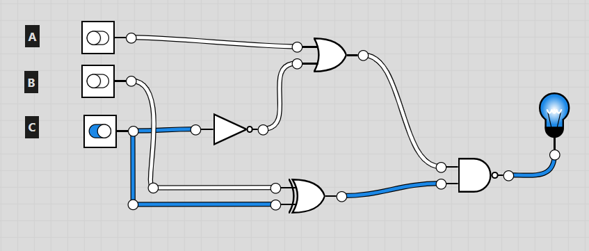
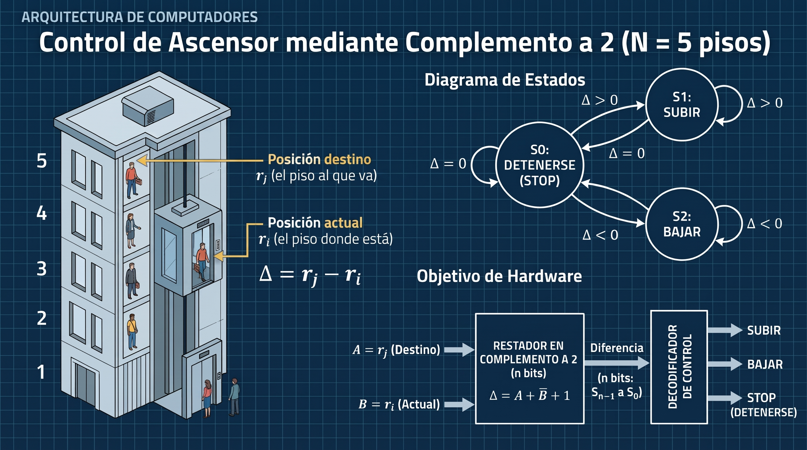

#+options: ':nil *:t -:t ::t <:t H:3 \n:nil ^:t arch:headline
#+options: author:t broken-links:nil c:nil creator:nil
#+options: d:(not "LOGBOOK") date:t e:t email:nil expand-links:t f:t
#+options: inline:t num:t p:nil pri:nil prop:nil stat:t tags:t
#+options: tasks:t tex:t timestamp:t title:t toc:nil todo:t |:t
#+title: Tarea de Ejercicios de Circuitos Digitales Combinatorios
#+date: 2026-11-04
#+author: COLOQUE SU NOMBRE
#+email: COLOQUE SU EMAIL
#+language: Español
#+select_tags: export
#+exclude_tags: noexport
#+creator: Emacs 27.1 (Org mode 9.7.5)
#+cite_export: biblatex

#+latex_class: article
#+latex_compiler: pdflatex

#+latex_header: \usepackage{fancyhdr}
#+latex_header: \usepackage[top=25mm, left=25mm, right=25mm]{geometry}
#+latex_header: \usepackage{longtable}
#+latex_header: \usepackage{tabularx}
#+latex_header: \usepackage{amsmath}
#+latex_header: \fancyhead[R]{}
#+latex_header: \setlength\headheight{43.0pt}
#+latex_header: \makeatletter
#+latex_header: \newcommand{\kc}[2]{\makebox[1.2cm][c]{\rule[-0.55cm]{0pt}{1.2cm}\in@{,#1,}{,#2,}\ifin@ 1\else 0\fi}}
#+latex_header: \makeatother
#+latex_header: \newcommand{\kmapthree}[1]{\begin{center}\begin{tabular}{c|*{4}{c|}}\multicolumn{1}{c}{$A\backslash BC$}&\multicolumn{1}{c}{00}&\multicolumn{1}{c}{01}&\multicolumn{1}{c}{11}&\multicolumn{1}{c}{10}\\\cline{2-5} 0&\kc{0}{#1}&\kc{1}{#1}&\kc{3}{#1}&\kc{2}{#1}\\\cline{2-5} 1&\kc{4}{#1}&\kc{5}{#1}&\kc{7}{#1}&\kc{6}{#1}\\\cline{2-5}\end{tabular}\end{center}}
#+latex_header: \newcommand{\kmapfour}[1]{\begin{center}\begin{tabular}{c|*{4}{c|}}\multicolumn{1}{c}{$AB\backslash CD$}&\multicolumn{1}{c}{00}&\multicolumn{1}{c}{01}&\multicolumn{1}{c}{11}&\multicolumn{1}{c}{10}\\\cline{2-5} 00&\kc{0}{#1}&\kc{1}{#1}&\kc{3}{#1}&\kc{2}{#1}\\\cline{2-5} 01&\kc{4}{#1}&\kc{5}{#1}&\kc{7}{#1}&\kc{6}{#1}\\\cline{2-5} 11&\kc{12}{#1}&\kc{13}{#1}&\kc{15}{#1}&\kc{14}{#1}\\\cline{2-5} 10&\kc{8}{#1}&\kc{9}{#1}&\kc{11}{#1}&\kc{10}{#1}\\\cline{2-5}\end{tabular}\end{center}}

#+bibliography: ../bibliography/bibliography.bib
#+LATEX_HEADER: \usepackage[T1]{fontenc}
#+LATEX_HEADER: \usepackage[utf8]{inputenc}
#+LATEX_HEADER: \usepackage[spanish]{babel}
#+LATEX_HEADER: \usepackage[backend=biber,style=ieee]{biblatex}

#+begin_export latex
\fancyhead[C]{\includegraphics[scale=0.05]{.././images/logoEPN.jpg}\\
ESCUELA POLITÉCNICA NACIONAL\\FACULTAD DE INGENIERÍA DE SISTEMAS\\
ARQUITECTURA DE COMPUTADORES}
\thispagestyle{fancy}
#+end_export

* Objetivos de Aprendizaje
- Obtener funciones booleanas en forma SOP y POS a partir de tablas de verdad.
- Simplificar funciones booleanas con álgebra de Boole y mapas de Karnaugh.
- Diseñar circuitos combinacionales: sumador binario y lógica de control.
- Aplicar el complemento a 2 y el bit de signo para comparar magnitudes
  (modelado de un ascensor).
- Ejercitar el uso de Emacs Org-mode, \LaTeX{} y la exportación a PDF.

* Instrucciones
1. Escriba todas las expresiones matemáticas en \LaTeX{} en los espacios
   provistos (reemplace los símbolos ~???~ o complete los renglones vacíos).
2. En los desarrollos algebraicos, cada línea del entorno ~align*~ es un
   paso de la reducción. Debajo, liste las *propiedades del álgebra de
   Boole* usadas.
3. En los ejercicios de simplificación algebraica debe /además/
   simplificar con *mapa de Karnaugh* y comparar ambos resultados.
4. En los espacios para circuitos, inserte la imagen de su dibujo o
   simulación (Matlab/Logisim) escribiendo la ruta relativa al archivo
   de imagen dentro del enlace Org-mode preparado.
5. Suba al aula virtual su archivo ~.org~ y el ~.pdf~ generado.

* Guía Emacs: \LaTeX{} y mapas de Karnaugh
** Ver las fórmulas dentro de Emacs
Ubique el cursor sobre una fórmula y ejecute ~C-c C-x C-l~
(~org-latex-preview~) para ver su vista previa sin generar el PDF.
Ejecute el mismo comando para ocultarla. Para generar el PDF use
~M-x org-latex-export-to-pdf~.

** Símbolos útiles de álgebra de Boole
| Operación         | Código \LaTeX{}   | Resultado       |
|-------------------+-------------------+-----------------|
| NOT (negación)    | ~\bar{A}~         | $\bar{A}$       |
| NOT de expresión  | ~\overline{A+B}~  | $\overline{A+B}$|
| XOR               | ~A \oplus B~      | $A \oplus B$    |
| AND / OR          | ~AB~, ~A+B~       | $AB$, $A+B$     |

** Desarrollos alineados con ~align*~
Para alinear los pasos de una reducción respecto del signo ~=~ use ~&=~
al inicio de cada línea y ~\\~ al final (excepto la última). Anote a la
derecha la propiedad con ~\text{}~ si lo desea:

#+begin_src latex
\begin{align*}
  F &= ABD + \bar{A}B\bar{C}D \\
    &= BD\,(A + \bar{A}\bar{C}) \\
    &= \dots
\end{align*}
#+end_src

Resultado:

\begin{align*}
  F &= ABD + \bar{A}B\bar{C}D \\
    &= BD\,(A + \bar{A}\bar{C}) \\
    &= \dots
\end{align*}

** Dibujar un mapa K con \LaTeX{}
Esta tarea ya define dos comandos en el encabezado que dibujan mapas
con las columnas en *código Gray* (00, 01, 11, 10):

- ~\kmapthree{lista}~: mapa de 3 variables ($A$ filas; $BC$ columnas).
- ~\kmapfour{lista}~: mapa de 4 variables ($AB$ filas; $CD$ columnas).

Se insertan dentro de un bloque de exportación (ya están colocados en
cada ejercicio).

#+begin_comment
Para llenar el mapa, edited el cuerpo de la tabla ~tabular~ (copie la
definición del encabezado a su respuesta) escribiendo los valores entire
los ampersands ~&~. Cada celda corresponde a un min-término. Por
ejemplo, para $F=\sum m(2,3,6)$ con 3 variables:

#+begin_src latex
\begin{center}\renewcommand{\arraystretch}{2.2}
\begin{tabular}{c|*{4}{p{1.3cm}|}}
\multicolumn{1}{c}{$A\backslash BC$} & \multicolumn{1}{c}{00} &
\multicolumn{1}{c}{01} & \multicolumn{1}{c}{11} & \multicolumn{1}{c}{10}\\
\cline{2-5}
0 & 0 & 0 & 1 & 1 \\ \cline{2-5}
1 & 0 & 0 & 0 & 1 \\ \cline{2-5}
\end{tabular}
\end{center}
#+end_src
#+end_comment

*Cómo llenar el mapa.* En cada ejercicio encontrará el comando con las
llaves vacías, por ejemplo ~\kmapthree{}~. Usted debe:

1. Determinar los *min-términos* donde $F=1$ (en una tabla de verdad,
   el número de fila en decimal; para una expresión, evalúela o
   expándala hasta min-términos). Con $A$ como bit más significativo,
   $m_6=110_2$ corresponde a $A=1,B=1,C=0$.
2. Escribir esos números *dentro de las llaves*, separados por comas y
   *sin espacios*.
3. Exportar o previsualizar: el comando coloca un 1 en las celdas de la
   lista y un 0 en las demás, y ordena las columnas en *código Gray*
   (00, 01, 11, 10).

Ejemplo (función distinta a las de la tarea): para
$F=\sum m(1,3,4)$ se escribe

#+begin_src org
,#+begin_export latex
\kmapthree{1,3,4}
,#+end_export
#+end_src

y se obtiene

#+begin_export latex
\kmapthree{1,3,4}
#+end_export

Con 4 variables funciona igual; por ejemplo ~\kmapfour{0,2,8,10}~
dibuja $F=\sum m(0,2,8,10)$.

Las agrupaciones no se dibujan automáticamente (no se generalizan de
forma eficiente): bajo el mapa liste los grupos formados y el término
que genera cada uno, y finalmente la función simplificada con
~align*~.

/Opcional:/ el paquete ~karnaugh-map~ (requiere ~tikz~) dibuja mapas
con agrupaciones coloreadas. Añádalo con
~#+latex_header: \usepackage{karnaugh-map}~ y use el entorno
~karnaugh-map~ (consulte la documentación del paquete con ~texdoc karnaugh-map~).

* Parte A. Álgebra de Boole
** Ejercicio 1: Circuitos Digitales
A partir del circuito combinacional de la Figura [[fig:circuito-tarea]] obtenga la expresión
booleana correspondiente y la tabla de verdad

#+caption: Circuito Combinacional
#+attr_latex: :width 0.75\textwidth :placement [h!]
#+NAME: fig:circuito-tarea

*Respuesta (expresión booleana):*

\begin{align*}
  F(A,B,C) &= \text{???}
\end{align*}

*Tabla de verdad:*

| A | B | C | F |
|---+---+---+---|
| 0 | 0 | 0 |   |
| 0 | 0 | 1 |   |
| 0 | 1 | 0 |   |
| 0 | 1 | 1 |   |
| 1 | 0 | 0 |   |
| 1 | 0 | 1 |   |
| 1 | 1 | 0 |   |
| 1 | 1 | 1 |   |

** Ejercicio 2: Compuerta XOR en SOP
A partir de la tabla de verdad de la compuerta OR exclusiva de dos
entradas obtenga la función booleana como suma de productos (SOP,
min-términos). Complete la tabla y la expresión.

| A | B | $A \oplus B$ |
|---+---+--------------|
| 0 | 0 |              |
| 0 | 1 |              |
| 1 | 0 |              |
| 1 | 1 |              |

*Respuesta (SOP):*

$$A \oplus B = ???$$

** Ejercicio 3: Compuerta XOR en POS
Para el ejercicio anterior obtenga la representación como producto de
sumas (POS, max-términos).

*Respuesta (POS):*

$$A \oplus B = ???$$

** Ejercicio 4: Implementación con NAND
¿Puede representar la XOR usando solamente compuertas NAND? Aplique las
leyes de De Morgan, recordando que una NAND es una AND negada
($\overline{AB}$). Desarrolle los pasos hasta obtener una expresión
únicamente con NAND y dibuje el circuito.

*Respuesta:*

\begin{align*}
  A \oplus B &= \bar{A}B + A\bar{B} \\
             &= \\
             &=
\end{align*}

*Propiedades del álgebra de Boole usadas:*
1. Propiedad ...
2. Propiedad ...
3. Propiedad ...

*Circuito con compuertas NAND:*

Coloque aquí la imagen del circuito: coloque el /path/ a la imagen y
remueva ~#+begin_src org~ y ~#+end_src~ para insertar la imagen en el pdf. 

#+begin_src org
#+caption: caption
#+attr_latex: scale=0.75
#+label: fig:label
[[file:]]
#+end_src

** Ejercicio 5: Simplificación algebraica I y mapa K
Simplifique $F = ACD+\bar{A}BCD$.

*a) Con álgebra de Boole:*

\begin{align*}
  F &= ACD+\bar{A}BCD \\
    &= \\
    &=
\end{align*}

*Propiedades del álgebra de Boole usadas* (indique el paso en que se usa cada una):
1. Propiedad ...
2. Propiedad ...
3. Propiedad ...

*b) Con mapa de Karnaugh (4 variables).* Escriba los min-términos
donde $F=1$ dentro de las llaves de ~\kmapfour{}~:

#+begin_export latex
\kmapfour{}
#+end_export

Min-términos: $F=\sum m(\ldots)$

Grupos formados y término que genera cada uno:

\begin{align*}
  G_1 &= \\
  G_2 &=
\end{align*}

\begin{align*}
  F_{\text{Karnaugh}} &=
\end{align*}

*c) Compare:* ¿coinciden los resultados de (a) y (b)? Comente.

*Respuesta:*

\vspace{1.5cm}

*d) Circuito con compuertas AND, OR y NOT.* Dibuje el circuito
correspondiente a la expresión simplificada:

Coloque aquí la imagen del circuito: escriba el  /path/ a la imagen y
remueva ~#+begin_src org~ y ~#+end_src~ para insertar la imagen en el pdf. 

#+begin_src org
#+caption: caption
#+attr_latex: scale=0.75
#+label: fig:label
[[file:]]
#+end_src

*e) Implementación usando solo compuertas NAND.* Obtenga una expresión
equivalente que utilice únicamente compuertas NAND:

\begin{align*}
  F_{\text{NAND}} &=
\end{align*}

Dibuje el circuito equivalente usando solo compuertas NAND:

Coloque aquí la imagen del circuito: escriba el  /path/ a la imagen y
remueva ~#+begin_src org~ y ~#+end_src~ para insertar la imagen en el pdf. 

#+begin_src org
#+caption: caption
#+attr_latex: scale=0.75
#+label: fig:label
[[file:]]
#+end_src

** Ejercicio 6: Simplificación algebraica II y mapa K
Simplifique $F=ABC+A\bar{B}\,\overline{\bar{A}\bar{C}}$.

*a) Con álgebra de Boole:*

\begin{align*}
  F &= ABC+A\bar{B}\,\overline{\bar{A}\bar{C}} \\
    &= \\
    &=
\end{align*}

*Propiedades del álgebra de Boole usadas:*
1. Propiedad ...
2. Propiedad ...
3. Propiedad ...

*b) Con mapa de Karnaugh (3 variables).* Obtenga los min-términos de
la expresión original y escríbalos dentro de las llaves de ~\kmapthree{}~:

#+begin_export latex
\kmapthree{}
#+end_export

Min-términos: $F=\sum m(\ldots)$

Grupos formados y término que genera cada uno:

\begin{align*}
  G_1 &= \\
  G_2 &=
\end{align*}

\begin{align*}
  F_{\text{Karnaugh}} &=
\end{align*}

*c) Compare:* ¿coinciden los resultados de (a) y (b)? Comente.

*Respuesta:*

\vspace{1.5cm}

* Parte B. Tablas de verdad y mapas de Karnaugh
** Ejercicio 7: Tablas de verdad en SOP y POS
Obtenga la tabla de verdad para cada función:

1. \(F = (A+\bar{B}+C)(\bar{A}+B+\bar{C})\)

   | A | B | C | F |
   |---+---+---+---|
   | 0 | 0 | 0 |   |
   | 0 | 0 | 1 |   |
   | 0 | 1 | 0 |   |
   | 0 | 1 | 1 |   |
   | 1 | 0 | 0 |   |
   | 1 | 0 | 1 |   |
   | 1 | 1 | 0 |   |
   | 1 | 1 | 1 |   |

2. \(F = AB+\bar{A}\bar{B}+A\bar{C}\)

   | A | B | C | F |
   |---+---+---+---|
   | 0 | 0 | 0 |   |
   | 0 | 0 | 1 |   |
   | 0 | 1 | 0 |   |
   | 0 | 1 | 1 |   |
   | 1 | 0 | 0 |   |
   | 1 | 0 | 1 |   |
   | 1 | 1 | 0 |   |
   | 1 | 1 | 1 |   |

** Ejercicio 8: SOP desde tabla de verdad
A partir de la tabla de verdad del Cuadro [[tab-ejercicio-1]] de tres variables obtenga la
representación en SOP.

#+CAPTION: Ejercicio 8
#+NAME: tab-ejercicio-1
| A | B | C | F |
|---+---+---+---|
| 0 | 0 | 0 | 0 |
| 0 | 0 | 1 | 0 |
| 0 | 1 | 0 | 1 |
| 0 | 1 | 1 | 1 |
| 1 | 0 | 0 | 0 |
| 1 | 0 | 1 | 0 |
| 1 | 1 | 0 | 1 |
| 1 | 1 | 1 | 0 |

*Respuesta:*

\begin{align*}
  F(A,B,C) &= \sum m(\ldots) \\
           &=
\end{align*}

** Ejercicio 9: Simplificación con mapa de Karnaugh
Usando mapas de Karnaugh simplifique la función de la tabla del
Ejercicio 8 y dibuje el circuito resultante.

Escriba los min-términos de $F$ (Ej. 8) dentro de las llaves:

#+begin_export latex
\kmapthree{}
#+end_export

Grupos formados:

\begin{align*}
  G_1 &= \\
  G_2 &=
\end{align*}

\begin{align*}
  F_{\text{simplificada}} &=
\end{align*}

*Circuito de la expresión simplificada:*

Coloque aquí la imagen del circuito: escriba el  /path/ a la imagen y
remueva ~#+begin_src org~ y ~#+end_src~ para insertar la imagen en el pdf. 

#+begin_src org
#+caption: caption
#+attr_latex: scale=0.75
#+label: fig:label
[[file:]]
#+end_src

Obtenga una expresión equivalente para implementar la función usando
solo compuertas NAND:

\begin{align*}
  F_{\text{NAND}} &=
\end{align*}

*Circuito usando solo compuertas NAND:*

Coloque aquí la imagen del circuito: escriba el  /path/ a la imagen y
remueva ~#+begin_src org~ y ~#+end_src~ para insertar la imagen en el pdf. 

#+begin_src org
#+caption: caption
#+attr_latex: scale=0.75
#+label: fig:label
[[file:]]
#+end_src

** Ejercicio 10: Karnaugh y simulación
Dada la siguiente tabla de verdad, simplifique utilizando un mapa de
Karnaugh, obtenga el circuito combinacional y simule el resultado.

#+CAPTION: Ejercicio 10
#+NAME: tab-ejercicio-2
| A | B | C | F |
|---+---+---+---|
| 0 | 0 | 0 | 1 |
| 0 | 0 | 1 | 1 |
| 0 | 1 | 0 | 0 |
| 0 | 1 | 1 | 1 |
| 1 | 0 | 0 | 0 |
| 1 | 0 | 1 | 1 |
| 1 | 1 | 0 | 0 |
| 1 | 1 | 1 | 1 |

Escriba los min-términos de $F$ dentro de las llaves:

#+begin_export latex
\kmapthree{}
#+end_export

Grupos formados:

\begin{align*}
  G_1 &= \\
  G_2 &=
\end{align*}

\begin{align*}
  F_{\text{simplificada}} &=
\end{align*}

*Captura de la simulación:*

Coloque aquí la imagen del circuito: escriba el  /path/ a la imagen y
remueva ~#+begin_src org~ y ~#+end_src~ para insertar la imagen en el pdf. 

#+begin_src org
#+caption: caption
#+attr_latex: scale=0.75
#+label: fig:label
[[file:]]
#+end_src

* Parte C. Sumador binario
** Ejercicio 11: Sumador completo en cascada
Obtenga un circuito combinacional que realice la suma binaria. Considere
que el sumador se resuelve integrando en cascada varias etapas que
suman los dígitos de los sumandos y el acarreo, que inicia en 0.
Consulte [cite:@stallings2006esp], páginas PDF 777 a 780 y
[cite:@stallings2022computer], páginas 435 a 438.

1. Complete la tabla de verdad de una etapa (sumador completo).

   | $C_i$ | $A_i$ | $B_i$ | $S_i$ | $C_{i+1}$ |
   |-------+-------+-------+-------+-----------|
   |     0 |     0 |     0 |       |           |
   |     0 |     0 |     1 |       |           |
   |     0 |     1 |     0 |       |           |
   |     0 |     1 |     1 |       |           |
   |     1 |     0 |     0 |       |           |
   |     1 |     0 |     1 |       |           |
   |     1 |     1 |     0 |       |           |
   |     1 |     1 |     1 |       |           |

2. Deduzca las expresiones booleanas reducidas (use mapas K de 3 variables).

   \begin{align*}
     S_i     &= \\
     C_{i+1} &=
   \end{align*}

3. Implemente el circuito en Matlab (o Logisim), simule e inserte la captura.

   Coloque aquí la imagen del circuito: escriba el  /path/ a la imagen
   y remueva ~#+begin_src org~ y ~#+end_src~ para insertar la imagen en el pdf. 

   #+begin_src org
   #+caption: caption
   #+attr_latex: scale=0.75
   #+label: fig:label
   [[file:]]
   #+end_src

4. Extienda el diseño a un sumador de 4 bits en cascada. Dibuje el
   diagrama de bloques.

   Coloque aquí la imagen del circuito: escriba el  /path/ a la imagen y
   remueva ~#+begin_src org~ y ~#+end_src~ para insertar la imagen en el pdf. 

   #+begin_src org
   #+caption: caption
   #+attr_latex: scale=0.75
   #+label: fig:label
   [[file:]]
   #+end_src

* Parte D. Modelado de un ascensor
** Ejercicio 12: Lógica de control de un ascensor de N pisos
#+caption: Diagrama del Control de un Ascensor
#+attr_latex: scale=0.75 :placement [h!]
#+label: fig:control-ascensor

El edificio de la facultad de Ingeniería de Sistemas de la Escuela
Politécnica Nacional dispone de un ascensor para 5 pisos (Figura
[[fig:control-ascensor]]). Diseñe un circuito combinacional en complemento
a 2 para controlar el movimiento del ascensor en tres estados (subir,
bajar, detener). Use estas variables:

- $r_i$: piso actual de la cabina, con $r_i \in \{1,2,3,4,5\}$.
- $r_j$: piso destino solicitado, con $r_j \in \{1,2,3,4,5\}$.
- $\Delta = r_j-r_i$: diferencia entre el piso destino y el piso actual.
- $A = (A_{n-1}A_{n-2}\dots A_1A_0)_2$: representación binaria de $r_j$.
- $B = (B_{n-1}B_{n-2}\dots B_1B_0)_2$: representación binaria de $r_i$.
- $S = (S_{n-1}S_{n-2}\dots S_1S_0)_2$: resultado de la resta en
  complemento a 2, con ancho $n$.

El circuito debe controlar los estados *SUBIR*, *BAJAR* y *DETENER* según
el valor de $\Delta$ mediante variables booleanas. ¿Puede el bit más
significativo de $S$ representar los estados de Subir y Bajar? ¿Cómo
puedo detectar que $S=0$?

Desarrolle los siguientes apartados. Muestre el procedimiento
matemático y dibuje los circuitos solicitados.

** Casos extremos y cantidad de bits
1. Determine los valores mínimo y máximo posibles de $\Delta$ e indique
   qué valores de $r_i$ y $r_j$ producen cada caso.
2. Determine cuántos bits, $m$, se requieren para codificar los pisos
   1 a 5.
3. Use el rango de complemento a 2 con $n$ bits,
   $[-2^{n-1},\,2^{n-1}-1]$, para plantear las desigualdades que debe
   cumplir $n$. Despeje $n$ de ambas desigualdades y elija un ancho que
   represente todo el intervalo de $\Delta$ sin desbordamiento.

\begin{align*}
  \Delta_{\min} &= r_j-r_i = \quad-\quad = \quad
    \quad (r_j=\quad,\;r_i=\quad) \\
  \Delta_{\max} &= r_j-r_i = \quad-\quad = \quad
    \quad (r_j=\quad,\;r_i=\quad) \\
  \Delta &\in [\quad,\quad] \\
  \text{número de bits }m\text{ para codificar cada piso} &= \\
  -2^{n-1} &\leq \Delta_{\min} \\
  \Delta_{\max} &\leq 2^{n-1}-1 \\
  n &\geq \quad \\
  n &= \quad
\end{align*}

** Resta mediante complemento a 2
La resta se implementa en el ancho de resultado $n$ como una suma en
complemento a 2:

#+begin_export latex
\begin{equation}
  \label{eq:resta-complemento-dos}
  \Delta = A-B = A+(-B)=A+C_2(B)=A+\overline{B}+1
\end{equation}
#+end_export

** Lógica de control
:PROPERTIES:
:CUSTOM_ID: logica-control
:END:
Complete la tabla de verdad usando los valores decimales con signo de
$\Delta$ y su representación en complemento a 2, $S$. En las columnas
de salida escriba 1 cuando se cumpla la condición indicada y 0 en caso
contrario: *DETENER* cuando $\Delta=0$, *BAJAR* cuando $\Delta<0$ y
*SUBIR* cuando $\Delta>0$. Use el bit de signo de $S$ para distinguir
la dirección y determine la condición necesaria para distinguir
$\Delta=0$ de $\Delta>0$.

| $\Delta$ (decimal) | $S=(S_{n-1}\dots S_1S_0)_2$ | DETENER | BAJAR | SUBIR |
|--------------------+-----------------------------+---------+-------+-------|
|                  0 | 00...0                      |   1     |  0    |  X    |
|                  1 | 00...1                      |   0     |  0    |  1    |
|                  2 | 00..10                      |   0     |  0    |  1    |
|                  3 |                             |         |       |       |
|                  4 |                             |         |       |       |
|                 -4 |                             |         |       |       |
|                 -3 |                             |         |       |       |
|                 -2 |                             |         |       |       |
|                 -1 | 11...1                      |  0      |  1    |  0    |

A partir de la tabla, obtenga las expresiones booleanas de las tres
salidas en función de los bits de $S$ y simplifíquelas al máximo.

\begin{align*}
  \text{DETENER}(S) &= \\
  \text{BAJAR}(S) &= \\
  \text{SUBIR}(S) &=
\end{align*}

** Implementación y verificación
Implemente el restador en complemento a 2 reutilizando el sumador
completo diseñado en el Ejercicio 11; no es necesario volver a diseñar
ese bloque. Conecte las entradas según la ecuación \ref{eq:resta-complemento-dos}
y añada la lógica de control obtenida en [[#logica-control]]. Simule el circuito y
compruebe que sus salidas coincidan con la tabla de verdad.

*Imagen del circuito implementado:* Escriba la ruta relativa de la
imagen y quite los delimitadores del bloque de código para insertarla
en el PDF. La captura ha de mostrar un caso de prueba y sus salidas.

#+begin_src org
#+caption: Restador en complemento a 2 y lógica de control del ascensor
#+attr_latex: :width 0.9\linewidth
#+name: fig:restador-control-ascensor
[[file:]]
#+end_src

* Rúbrica de evaluación
| Criterio                                        | Puntaje máximo |
|-------------------------------------------------+----------------|
| Parte A: Álgebra de Boole y mapas K (Ej. 1-6)   |             30 |
| Parte B: Tablas de verdad y Karnaugh (Ej. 7-10) |             20 |
| Parte C: Sumador binario (Ej. 11)               |             15 |
| Parte D: Ascensor (Ej. 12)                      |             30 |
| Presentación, uso de Org-mode/\LaTeX{} y PDF    |              5 |
| TOTAL                                           |            100 |

* Verificación de Entregables [0%]:
- [ ] Todos los ejercicios resueltos y justificados en \LaTeX{}
- [ ] Propiedades del álgebra de Boole listadas en cada simplificación
- [ ] Capturas de simulaciones insertadas
- [ ] Revisión de ortografía con ~ispell-buffer~
- [ ] Generación de PDF ~M-x org-latex-export-to-pdf~
- [ ] Subir al aula virtual ~.org~ y ~.pdf~

** Problemas con la Tarea/logísticos:
- Ejercicio $X_1$ no pudo completarse debido a

* Referencias
#+print_bibliography:
